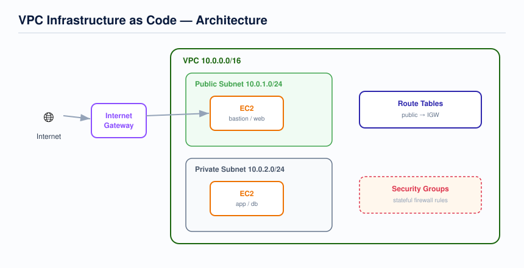

# VPC Infrastructure as Code

A custom AWS network built entirely in **Terraform** — a VPC with public and private subnets, an Internet Gateway, route tables, and security groups, with EC2 instances deployed into controlled subnets. This is the networking foundation almost every other AWS workload sits on top of.



## What it builds

- A **VPC** (`10.0.0.0/16`) as an isolated network boundary.
- A **public subnet** (`10.0.1.0/24`) with a route to an **Internet Gateway** for internet-facing resources.
- A **private subnet** (`10.0.2.0/24`) with no direct internet route — for application and data tiers.
- **Route tables** wiring the public subnet to the IGW.
- **Security groups** acting as stateful, instance-level firewalls.
- **EC2 instances** placed in each subnet to demonstrate the access boundaries.

## Why I built it

Networking is the part of AWS that trips most people up, so I wanted to build a VPC from scratch rather than relying on the default one. Doing it as code (instead of clicking through the console) forced me to understand exactly how subnets, route tables, and gateways relate — and means the whole environment can be torn down and rebuilt identically with one command.

## Tech stack

Terraform · VPC · Subnets · Internet Gateway · Route Tables · Security Groups · EC2

## Deploy

> Requires Terraform and the AWS CLI configured with your credentials.

```bash
terraform init      # download the AWS provider
terraform plan      # preview what will be created
terraform apply     # build the network
terraform destroy   # tear it all down cleanly
```

## What I learned

- The difference between a security group (stateful, instance-level) and a network ACL (stateless, subnet-level).
- Why a subnet is only "public" because of its **route table**, not the name.
- How Terraform state tracks real infrastructure, and why `plan` before `apply` matters.

## What I'd do next

- Add a NAT Gateway so private instances can reach the internet for updates without being publicly reachable.
- Split the configuration into reusable modules.
- Add multi-AZ subnets for high availability.

---

*Part of my AWS portfolio — see more at [vithu.cloud](https://vithu.cloud) and [github.com/vithushanth](https://github.com/vithushanth).*
